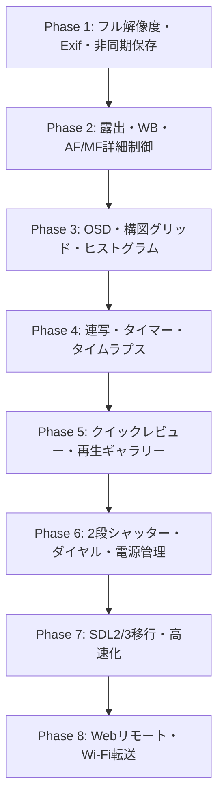

# デジタルスチルカメラ (DSC) 機能実装ロードマップ / TODO.md

本ドキュメントは、Raspberry Pi + libcamera + SDL をベースとしたカメラアプリケーションを、本格的な**デジタルスチルカメラ（DSC: Digital Still Camera）**として発展させるために必要な機能一覧および開発ロードマップをまとめたものです。

プロジェクトルートの [`../TODO.md`](../TODO.md) と共通のドキュメントです。

---

## 目次

1. [現在の実装状況 (現状サマリー)](#現在の実装状況-現状サマリー)
2. [開発フェーズ概要](#開発フェーズ概要)
3. [機能一覧 & TODO リスト](#機能一覧--todo-リスト)
   - [Phase 1: 静止画キャプチャ・画質パイプライン強化 (最優先)](#phase-1-静止画キャプチャ画質パイプライン強化-最優先)
   - [Phase 2: 露出・ホワイトバランス・光学制御 (手動・自動設定)](#phase-2-露出ホワイトバランス光学制御-手動自動設定)
   - [Phase 3: ビューファインダー・構図支援・OSD (HUD)](#phase-3-ビューファインダー構図支援osd-hud)
   - [Phase 4: ドライブモード・特殊撮影機能](#phase-4-ドライブモード特殊撮影機能)
   - [Phase 5: 再生・ギャラリー・メディア管理](#phase-5-再生ギャラリーメディア管理)
   - [Phase 6: ハードウェア連携・電源・組み込みDSC化](#phase-6-ハードウェア連携電源組み込みdsc化)
   - [Phase 7: システム基盤・グラフィックス近代化 (SDL2/3)](#phase-7-システム基盤グラフィックス近代化-sdl23)
   - [Phase 8: ネットワーク・スマート機能 (拡張)](#phase-8-ネットワークスマート機能-拡張)
4. [推奨ハードウェア構成例](#推奨ハードウェア構成例)

---

## 現在の実装状況 (現状サマリー)

- [x] **リアルタイムプレビュー**: SDL2 GPU レンダリングを用いた ~30 FPS プレビュー表示 & アスペクト比維持スケーリング
- [x] **libcamera C++ ラッパー**: C11 から `extern "C"` 経由で libcamera を呼び出し
- [x] **基本オートフォーカス**: 常時追従AF (Continuous AF) & ワンショットAF再調整 (Fキー)
- [x] **ワンキー撮影**: Spaceキーによる高解像度JPEG保存 (`SDL2_image` / `IMG_SaveJPG`, マルチストリーム / モード切替対応)
- [x] **DCF 準拠ファイル管理**: `DCIM/100_PICA/IMG_0001.JPG` (または日付別 `DCIM/YYYYMMDD/`) の自動採番・残容量チェック
- [x] **モダンOSD**: `SDL2_ttf` によるアンチエイリアス TrueType フォント & GPU 半透明ガイドオーバーレイ
- [x] **シグナルハンドリング**: `Ctrl + C` による安全なリソース解放

---

## 開発フェーズ概要

---

## 機能一覧 & TODO リスト

各項目には優先度 `[高/中/低]` と難易度目安 `[易/並/難]` を付与しています。

### Phase 1: 静止画キャプチャ・画質パイプライン強化 (最優先)

デジタルカメラとしての最も根幹である「撮影画像の高画質化」と「データ管理」の基盤を整備します。

- [x] **高解像度静止画ストリームの分離 (Still Stream)** `[優先度: 高]` `[難易度: 並]`
  - 現状のプレビュー解像度 (1024x600) のまま保存する仕様を改め、センサー本来のフル解像度 (例: Camera Module 3 であれば 12MP 4608x2592) で静止画をキャプチャ。
  - *技術方針*: libcamera のマルチストリーム機能 (Viewfinder用 + Still用の2系統構成) を構成、または撮影トリガー時に高解像度リクエストを発行。
- [ ] **Exif メタデータの付加** `[優先度: 高]` `[難易度: 並]`
  - 撮影日時、カメラモデル名、シャッター速度、F値、ISO感度、ホワイトバランス、露出補正値、焦点距離を Exif 規格に沿って JPEG ヘッダーに埋め込み。
  - *技術方針*: `libexif` の導入、または Exif APP1 マーカー生成ルーチンの実装。
- [ ] **非同期キャプチャ & バックグラウンド保存キュー** `[優先度: 高]` `[難易度: 並]`
  - JPEG エンコードおよび SD カードへのファイル書き込みを別スレッドで処理し、撮影時のプレビューフリーズ（シャッターラグ）を最小化。
- [x] **DCF (Design rule for Camera File system) 準拠のファイル命名・ディレクトリ管理** `[優先度: 中]` `[難易度: 易]`
  - `DCIM/100_PICA/IMG_0001.JPG` などのカメラ業界標準フォルダ構造、または日付別フォルダ (`DCIM/YYYYMMDD/`) への自動保存。
  - 連番の重複チェック・保存先ストレージ残容量の事前確認。
- [ ] **RAW / DNG 記録対応** `[優先度: 中]` `[難易度: 難]`
  - libcamera の Bayer RAW ストリームを取得し、Adobe DNG 形式で保存。現像ソフト (Lightroom, Darktable 等) での本格現像を可能にする。
  - `RAW+JPEG` 同時保存モードのサポート。
- [ ] **JPEG 保存品質設定 (クオリティ/圧縮率)** `[優先度: 低]` `[難易度: 易]`
  - SuperFine (98%), Fine (90%), Normal (80%) などの画質選択設定。

---

### Phase 2: 露出・ホワイトバランス・光学制御 (手動・自動設定)

プロフェッショナルなカメラに必須の露出制御・フォーカス微調整機能を追加します。

- [ ] **露出補正 (EV Compensation)** `[優先度: 高]` `[難易度: 易]`
  - `+/- 3.0 EV` (1/3 EV ステップ) での露出明るさ調整。
  - *libcamera*: `controls::ExposureValue` を設定。
- [ ] **ISO感度 (ゲイン) 手動設定** `[優先度: 高]` `[難易度: 並]`
  - Auto / 100 / 200 / 400 / 800 / 1600 / 3200 の切り替え。
  - *libcamera*: `controls::AnalogueGain` を手動制御。
- [ ] **シャッタースピード手動設定** `[優先度: 高]` `[難易度: 並]`
  - Auto / 1/2000s 〜 1秒、長時間露光 (数秒) のサポート。
  - *libcamera*: `controls::ExposureTime` をマイクロ秒単位で設定。
- [ ] **ホワイトバランス (AWB / 手動プリセット)** `[優先度: 高]` `[難易度: 易]`
  - Auto / 晴天 (Daylight) / 曇天 (Cloudy) / 日陰 (Shade) / 白熱灯 (Tungsten) / 蛍光灯 (Fluorescent) / 色温度手動指定 (K値)。
  - AWB ロック機能 (現在の色合いで固定)。
  - *libcamera*: `controls::AwbMode`, `controls::ColourGains`。
- [ ] **測光モード切替 (Metering Mode)** `[優先度: 中]` `[難易度: 易]`
  - 評価測光 (Matrix) / 中央重点測光 (CentreWeighted) / スポット測光 (Spot)。
  - *libcamera*: `controls::AeMeteringMode`。
- [ ] **マニュアルフォーカス (MF) & ステップ調整** `[優先度: 中]` `[難易度: 並]`
  - レンズ駆動位置を微小ステップで手動送り/戻し。
  - *libcamera*: `controls::AfMode = AfModeManual`, `controls::LensPosition` を操作。
- [ ] **フォーカスピーキング (ピント合焦アシスト)** `[優先度: 中]` `[難易度: 並]`
  - ソーベルフィルタ/ラプラシアンフィルタによりエッジの高周波成分を検出し、合焦部分に色付き輪郭（赤/緑/白）をオーバーレイ描画。
- [ ] **拡大フォーカスアシスト (Focus Magnifier)** `[優先度: 中]` `[難易度: 易]`
  - MF 操作時、画面中央部を 2x / 4x にデジタル拡大表示して厳密なピント合わせをサポート。
- [ ] **画質プロファイル設定** `[優先度: 低]` `[難易度: 易]`
  - コントラスト、彩度 (Saturation)、シャープネス (Sharpness) の微調整。
  - モノクロ (白黒) / セピア撮影モード。

---

### Phase 3: ビューファインダー・構図支援・OSD (HUD)

撮影者が被写体を的確に捉え、カメラの状態を一目で把握できるようにします。

- [ ] **撮影パラメータ OSD (HUD表示)** `[優先度: 高]` `[難易度: 易]`
  - 画面の四隅・下部に以下の情報をリアルタイム表示:
    - シャッター速度、絞り (固定またはF値)、ISO 感度、EV 補正値
    - AF 合焦マーク (●: 合焦、○: 探索中、✕: フォーカス不能)
    - 保存フォーマット (JPEG / RAW / RAW+JPEG) & 解像度
    - バッテリー残量 (アイコン/％)
    - SDカード残容量 & 残り撮影可能枚数概算
- [ ] **構図ガイドグリッド** `[優先度: 高]` `[難易度: 易]`
  - 三分割グリッド (Rule of Thirds)
  - 黄金比グリッド (Golden Ratio)
  - 十字センターマーク
  - アスペクト比マスク (16:9, 4:3, 1:1, 3:2)
- [ ] **リアルタイム・ヒストグラム** `[優先度: 中]` `[難易度: 並]`
  - プレビュー画面の輝度分布 (Yヒストグラム) または RGB 各チャンネルのヒストグラムを画面隅にグラフ表示。
- [ ] **ゼブラパターン (白飛び警告)** `[優先度: 中]` `[難易度: 並]`
  - 露出オーバー (輝度 95% 以上等) の領域に斜線ストライプパターンを点滅描画。
- [ ] **電子水準器 (デジタルレベラー)** `[優先度: 低]` `[難易度: 並]`
  - 加速度センサ (I2C 接続の MPU6050 等) と連携し、水平・あおり角の傾きインジケータを画面中央に描画。
- [ ] **OSD 表示モード切替 (DISP キー)** `[優先度: 中]` `[難易度: 易]`
  - `全情報表示` → `簡易表示` → `グリッドのみ` → `クリーンビュー (情報非表示)` をトグル切り替え。

---

### Phase 4: ドライブモード・特殊撮影機能

静止画撮影のバリエーションを広げ、多様な撮影シーンに対応します。

- [ ] **セルフタイマー撮影** `[優先度: 高]` `[難易度: 易]`
  - 2秒 / 10秒タイマー。
  - 画面上でのカウントダウン数値表示 & 音声ビープ / LED 点滅。
- [ ] **連写モード (Burst / Continuous Shooting)** `[優先度: 高]` `[難易度: 並]`
  - シャッター長押し中に最高速度 (例: 5〜10 fps) で連続撮影。
  - メモリリングバッファを用いたコマ落ちのない連続キャプチャ。
- [ ] **インターバル撮影 (タイムラプス)** `[優先度: 中]` `[難易度: 並]`
  - 撮影間隔 (1秒〜60分)、総撮影枚数の指定による自動撮影。
  - 撮影完了後に自動でタイムラプス動画 (MP4) を生成するオプション。
- [ ] **オートブラケティング (AEB: Auto Exposure Bracketing)** `[優先度: 中]` `[難易度: 並]`
  - 基準露出、アンダー (-1EV)、オーバー (+1EV) の3枚を連続撮影。明暗差の激しいシーンの保険やHDR合成用素材に利用。
- [ ] **動画撮影モードへの切替** `[優先度: 低]` `[難易度: 難]`
  - 静止画モード / 動画モードのトグル。
  - H.264 ハードウェアエンコーダを用いた 1080p 30/60fps の動画記録。

---

### Phase 5: 再生・ギャラリー・メディア管理

撮影した写真の確認・整理・削除をスタンドアロンで行えるようにします。

- [ ] **撮影直後プレビュー (Quick Review / Auto Review)** `[優先度: 高]` `[難易度: 易]`
  - シャッター後、撮影した静止画を 1〜2 秒間自動で全画面表示して直前確認。
  - その間に特定のキー (例: Deleteキー) を押すと即座に破棄可能。
- [ ] **再生モード (Play / Gallery Mode)** `[優先度: 高]` `[難易度: 並]`
  - 撮影モードと再生モードのトグル切り替え。
  - 左右キーで前後の写真送り。
  - 詳細 Exif 情報のオーバーレイ表示。
- [ ] **再生時ズーム・パン (ピント確認)** `[優先度: 中]` `[難易度: 並]`
  - 撮影済み写真を 2x, 4x, 8x 等で等倍までデジタル拡大し、ブレやピントのズレをチェック。
- [ ] **サムネイル一覧インデックス画面** `[優先度: 低]` `[難易度: 並]`
  - 3x3 や 4x4 のグリッド状にサムネイルを並べて写真を素早く探す機能。
- [ ] **写真の削除 & プロテクト (保護)** `[優先度: 中]` `[難易度: 易]`
  - 1枚削除、全削除、誤削除を防ぐ保護フラグの付与。
- [ ] **USBマスストレージ / PTP (Picture Transfer Protocol) 連携** `[優先度: 低]` `[難易度: 難]`
  - Raspberry Pi を PC に USB 接続した際、デジカメ (PTP/MTP) または USB メモリとして認識させ写真を取り出し。

---

### Phase 6: ハードウェア連携・電源・組み込みDSC化

Raspberry Pi を「箱（ボディ）」に収めて本物の単体デジタルカメラとして持ち運べるようにします。

- [ ] **2段シャッターボタン対応 (GPIO 割り込み)** `[優先度: 高]` `[難易度: 並]`
  - ハードウェアの2段押しタクトスイッチに対応:
    - **半押し (S1)**: AF 実行 & AE/AF ロック
    - **全押し (S2)**: 撮影実行
- [ ] **物理ダイヤル / ロータリーエンコーダ対応** `[優先度: 高]` `[難易度: 並]`
  - 回転ダイヤルで露出補正、シャッター速度、ISO、またはメニュー選択を直感的に操作。
- [ ] **タッチスクリーン操作 (タッチパネルLCD対応時)** `[優先度: 中]` `[難易度: 並]`
  - 画面タップで任意の場所へピントを合わせる「タッチAF」。
  - 画面上のアイコンタップによるモード切替やメニュー操作。
- [ ] **電源管理・自動スタンバイ・安全シャットダウン** `[優先度: 高]` `[難易度: 並]`
  - 無操作が続いた場合の画面減光 / ディスプレイ消灯 (オートパワーセーブ)。
  - 電源ボタン長押しで OS の安全シャットダウン (`system("poweroff")` またはシグナル連携)。
- [ ] **バッテリー監視 (ADC / I2C PMIC / PiJuice)** `[優先度: 高]` `[難易度: 並]`
  - バッテリー残量電圧を取得し、低電圧時の警告および安全シャットダウン。
- [ ] **サウンド & LED フィードバック** `[優先度: 中]` `[難易度: 易]`
  - スピーカー / ピエゾブザーによる電子シャッター音、AF合焦音、タイマー予告音。
  - GPIO LED による書き込み中ランプ、セルフタイマー点滅インジケータ。

---

### Phase 7: システム基盤・グラフィックス近代化 (SDL2/3)

安定性、描画パフォーマンス、保守性を向上させます。

- [x] **SDL2 (および SDL2_ttf) へのマイグレーション** `[優先度: 高]` `[難易度: 並]`
  - レガシーな SDL 1.2 から SDL2 / SDL2_ttf へ移行完了。
  - ハードウェアアクセラレーション (OpenGL ES / KMSDRM) による GPU レンダリング (`SDL_Renderer`, `SDL_Texture`)。
  - スケーリング処理の GPU オフロード (アスペクト比維持レターボックス/ピラーボックスフィット)。
  - TrueType フォントによる美麗な OSD ガイド描画とテクスチャキャッシュによる低負荷化。
- [ ] **設定の永続化 (Config ファイル保存・読み込み)** `[優先度: 高]` `[難易度: 易]`
  - 前回終了時の設定 (グリッド表示、ISO、タイマー設定等) を JSON / INI ファイルに保存し、次回起動時に自動復元。
- [ ] **ゼロコピー DMA-BUF レンダリング最適化** `[優先度: 中]` `[難易度: 難]`
  - libcamera の DMA-BUF フレームバッファを CPU コピーなしでダイレクトに OpenGL テクスチャ (EGLImage) にバインドし、CPU 負荷を極小化。

---

### Phase 8: ネットワーク・スマート機能 (拡張)

Raspberry Pi ならではのスマートカメラ機能を付加します。

- [ ] **Web ブラウザによるリモートコントロール (Wi-Fi リモートレリーズ)** `[優先度: 中]` `[難易度: 並]`
  - 軽量な組み込み HTTP/WebSocket サーバーを内蔵し、スマホのブラウザからプレビュー確認 & 撮影トリガー。
- [ ] **Bluetooth リモコンシャッター対応** `[優先度: 中]` `[難易度: 易]`
  - 市販の 100 均等の Bluetooth スマホシャッターボタン (HID ボリュームキー等) を検知してレリーズ。
- [ ] **Wi-Fi 自動バックアップ / クラウド同期** `[優先度: 低]` `[難易度: 並]`
  - 自宅 Wi-Fi に接続されたら、撮影画像を NAS や Google Drive、Nextcloud へバックグラウンド自動同期。
- [ ] **GPS ジオタグ記録** `[優先度: 低]` `[難易度: 並]`
  - USB-GPS モジュールまたはスマホテザリング位置情報を Exif GPS タグに書き込み。

---

## 推奨ハードウェア構成例

自作デジタルスチルカメラ（DIY DSC）を構築する場合の代表的なハードウェア組み合わせ例です。

| 構成要素 | 推奨パーツ例 | 備考 |
| :--- | :--- | :--- |
| **SBC** | Raspberry Pi 4 Model B / Raspberry Pi 5 | 高速な画像処理・低遅延 |
| **カメラモジュール** | Raspberry Pi Camera Module 3 (標準 or Wide) | オートフォーカス対応 (IMX708, 12MP) |
| **ディスプレイ** | 3.5〜5.0 インチ HDMI / DSI 静電容量タッチ液晶 | 800x480 または 1024x600 程度が最適 |
| **シャッター** | 2段階押しタクトスイッチ (半押し/全押し) | GPIO 接続 |
| **ダイヤル** | EC11 ロータリーエンコーダ (プッシュスイッチ付き) | 露出補正やメニュー送りに使用 |
| **電源・バッテリー** | 18650 リチウムイオン電池 + UPS モジュール (PiJuice 等) | I2C による残量モニタリング対応 |
| **ボディ** | 3Dプリンタ製カスタムカメラケース | 三脚ネジ穴 (1/4インチ) 埋め込み推奨 |
