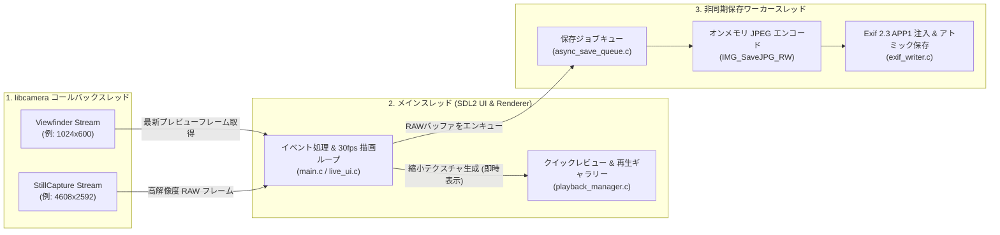

# RubusCam アーキテクチャ & 内部設計ドキュメント

本ドキュメントでは、**RubusCam** のソースコード構成、モジュール間の責務分担、非同期キャプチャ・保存パイプラインのスレッドモデル、および `libcamera` C ラッパー API について解説します。

---

## 目次

1. [ディレクトリ構成と各モジュールの役割](#1-ディレクトリ構成と各モジュールの役割)
2. [システムアーキテクチャとスレッドモデル](#2-システムアーキテクチャとスレッドモデル)
3. [libcamera ラッパー API リファレンス (`camera_stream.h`)](#3-libcamera-ラッパー-api-リファレンス-camera_streamh)

---

## 1. ディレクトリ構成と各モジュールの役割

`libcamera` は公式に C++20 API のみを提供しているため、`camera_stream.cpp` のみを C++ で実装し、`extern "C"` で囲んだ不透明構造体 (`CameraStream`) と C 関数群として公開しています。メインループや UI・Exif・ストレージ管理・非同期キューはすべて **C11** で実装されています。

```text
RubusCam/
├── CMakeLists.txt             # CMake ビルド設定 (C11 & C++20 混在ビルド)
├── Makefile                   # 簡易 make ビルド設定 (gcc + g++)
├── LICENSE                    # MIT ライセンス
├── README.md                  # プロジェクト概要・クイックスタート
├── docs/
│   ├── USER_GUIDE.md          # 操作・設定マニュアル
│   ├── ARCHITECTURE.md        # 内部設計・API仕様書 (本ドキュメント)
│   └── TODO.md                # 機能拡張ロードマップ
├── include/
│   ├── async_save_queue.h     # 非同期 JPEG エンコード & バックグラウンド保存キュー宣言
│   ├── camera_stream.h        # libcamera ラッパー関数の C 向け公開ヘッダー (extern "C")
│   ├── dcf_storage.h          # DCF 準拠ディレクトリ・連番ファイル管理・残容量確認・メディア走査ヘッダー
│   ├── exif_writer.h          # Exif 2.3 (APP1) セグメント生成・JPEG 注入ヘッダー
│   ├── live_ui.h              # ライブビュー撮影 UI・ポップアップ設定・タッチAF管理ヘッダー
│   ├── playback_manager.h     # クイックレビュー・再生ギャラリー・ズーム/グリッド/削除管理ヘッダー
│   └── text_renderer.h        # SDL2_ttf 用テキスト・ボタン・パネル描画 & 共通UIユーティリティ宣言
└── src/
    ├── main.c                 # アプリケーションエントリポイント & SDL2 イベント/レンダリングループ (C11)
    ├── async_save_queue.c     # 非同期保存ワーカースレッド & キュー管理実装 (C11)
    ├── camera_stream.cpp      # libcamera 制御実装 & extern "C" ラッパー関数群 (C++20)
    ├── dcf_storage.c          # DCF フォルダ自動生成・連番採番・statvfs 残容量チェック・ファイル削除/保護実装 (C11)
    ├── exif_writer.c          # TIFF IFD / Exif 2.3 バイナリ構築 & アトミック保存実装 (C11)
    ├── live_ui.c              # ライブビュー撮影 UI・設定カラム/ポップアップ・タッチAF制御実装 (C11)
    ├── playback_manager.c     # 再生モード・クイックレビュー・Exif パーサ・サムネイル一覧実装 (C11)
    └── text_renderer.c        # SDL2_ttf テキストキャッシュ・ボタン・パネル描画実装 (C11)
```

---

## 2. システムアーキテクチャとスレッドモデル

RubusCam は撮影時のプレビューフリーズ（シャッターラグ）や UI の引っかかりを防ぐため、以下の3つのスレッド系統で協調動作します。



### 2.1 マルチストリーム構成とフォールバック (`camera_stream.cpp`)
- **2系統マルチストリーム**: 可能な場合、低遅延プレビュー用の `Viewfinder` ストリーム（例: `1024x600`）と、センサー最大解像度の `StillCapture` ストリーム（例: `4608x2592`）を同時に構成します。
- **モード切替フォールバック**: ISP やメモリの制約で2系統同時構成ができない環境では、通常時は `Viewfinder` で動作し、シャッター押下時に自動で高解像度ストリームへ再構成してキャプチャ後、`Viewfinder` に復帰します。

### 2.2 非同期保存パイプライン (`async_save_queue.c` / `exif_writer.c`)
1. シャッターが押されると、取得した高解像度 RAW フレームからメインスレッドで即座にクイックレビュー用テクスチャを生成して画面に表示します。
2. 同時に RAW フレームバッファと撮影時のメタデータ（SS, ISO, EV, WB, モデル名等）を `AsyncSaveQueue` にエンキューします。
3. バックグラウンドの専用ワーカースレッドが `SDL_RWops` + `IMG_SaveJPG_RW` を用いて**オンメモリで JPEG エンコード**を行い、生成した Exif 2.3 `APP1` セグメントと結合して一時ファイル (`.tmp`) に書き出した後、`rename()` によりアトミックに目的のファイル名（`IMG_XXXX.JPG`）へ確定させます。
4. クイックレビュー中にユーザーが即時削除（キャンセル）を行った場合は、キュー内の未処理ジョブ取り消し、または書き込み完了直後のファイル削除を安全に処理します。

### 2.3 文字列・UI テクスチャキャッシュ (`text_renderer.c`)
- `SDL2_ttf` による毎フレームの文字列ラスタライズおよび GPU テクスチャ生成コストを抑えるため、`TextRenderer` 内部に LRU 方式の文字列テクスチャキャッシュを保持し、再生モードのグリッド一覧や OSD 描画時の CPU/GPU 負荷を最小化しています。

---

## 3. libcamera ラッパー API リファレンス (`camera_stream.h`)

C言語側からは [include/camera_stream.h](../include/camera_stream.h) に定義された以下の `extern "C"` 関数を通じてカメラを操作します。

### 3.1 ライフサイクル・初期化・開始/停止

```c
CameraStream *camera_stream_create(void);
void camera_stream_destroy(CameraStream *cam);

void camera_stream_set_still_size(CameraStream *cam, int still_width, int still_height);
bool camera_stream_init(CameraStream *cam, int width, int height);
bool camera_stream_start(CameraStream *cam);
void camera_stream_stop(CameraStream *cam);
```

### 3.2 カメラ情報・フォーマット取得

```c
bool camera_stream_is_af_supported(const CameraStream *cam);
const char *camera_stream_get_model_name(const CameraStream *cam);

int camera_stream_get_width(const CameraStream *cam);
int camera_stream_get_height(const CameraStream *cam);
int camera_stream_get_stride(const CameraStream *cam);
size_t camera_stream_get_frame_size(const CameraStream *cam);
bool camera_stream_is_bgr(const CameraStream *cam);

int camera_stream_get_still_width(const CameraStream *cam);
int camera_stream_get_still_height(const CameraStream *cam);
```

### 3.3 プレビューフレーム取得

```c
bool camera_stream_get_latest_frame(
    CameraStream *cam,
    uint8_t *out_buffer,
    size_t buffer_size,
    uint64_t *out_sequence);
```

### 3.4 露出・ホワイトバランス・測光制御

```c
bool camera_stream_set_ev(CameraStream *cam, float ev);
bool camera_stream_set_iso(CameraStream *cam, int iso);
bool camera_stream_set_shutter_speed(CameraStream *cam, int32_t exposure_time_us);
bool camera_stream_set_wb_mode(CameraStream *cam, CameraWbMode mode);
bool camera_stream_set_wb_kelvin(CameraStream *cam, int kelvin);
bool camera_stream_set_awb_lock(CameraStream *cam, bool locked);
bool camera_stream_set_metering_mode(CameraStream *cam, CameraMeteringMode mode);
void camera_stream_get_exposure_status(const CameraStream *cam, CameraExposureStatus *out_status);
```

### 3.5 オートフォーカス (AF) 制御

```c
bool camera_stream_trigger_af(CameraStream *cam);
bool camera_stream_trigger_touch_af(CameraStream *cam, float norm_x, float norm_y);
CameraAfStatus camera_stream_get_af_status(const CameraStream *cam);
```

### 3.6 高解像度静止画キャプチャ（非同期）

```c
bool camera_stream_request_still(CameraStream *cam);
bool camera_stream_is_still_pending(const CameraStream *cam);
bool camera_stream_poll_captured_still(CameraStream *cam, CameraCapturedStill *out_still);
```

