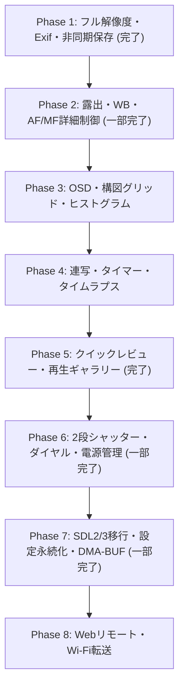

# デジタルスチルカメラ (DSC) 機能実装ロードマップ / TODO.md

本ドキュメントは、Raspberry Pi + libcamera + SDL2 をベースとした **RubusCam** を、本格的な**デジタルスチルカメラ（DSC: Digital Still Camera）**として発展させるための機能一覧および開発ロードマップをまとめたものです。

現在の機能や操作方法については [README.md](../README.md) および [USER_GUIDE.md](USER_GUIDE.md) を参照してください。

---

## 目次

1. [開発フェーズ概要 & 進捗サマリー](#1-開発フェーズ概要--進捗サマリー)
2. [今後の実装タスク (Phase 2 〜 Phase 8)](#2-今後の実装タスク-phase-2--phase-8)
   - [Phase 2: 露出・ホワイトバランス・光学制御 (残り: MF・アシスト・画質調整)](#phase-2-露出ホワイトバランス光学制御)
   - [Phase 3: ビューファインダー・構図支援・OSD (HUD)](#phase-3-ビューファインダー構図支援osd-hud)
   - [Phase 4: ドライブモード・特殊撮影機能](#phase-4-ドライブモード特殊撮影機能)
   - [Phase 6: ハードウェア連携・電源・組み込みDSC化](#phase-6-ハードウェア連携電源組み込みdsc化)
   - [Phase 7: システム基盤・グラフィックス近代化 (SDL2/3)](#phase-7-システム基盤グラフィックス近代化-sdl23)
   - [Phase 8: ネットワーク・スマート機能 (拡張)](#phase-8-ネットワークスマート機能-拡張)
3. [推奨ハードウェア構成例](#3-推奨ハードウェア構成例)
4. [完了済みマイルストーン・改善履歴](#4-完了済みマイルストーン改善履歴)

---

## 1. 開発フェーズ概要 & 進捗サマリー

| フェーズ | テーマ | 状態 | 主な実装状況 |
| :--- | :--- | :---: | :--- |
| **Phase 1** | 静止画キャプチャ・画質パイプライン強化 | **完了** | マルチストリーム高解像度撮影、Exif 2.3、非同期保存キュー、DCF管理、JPEG品質設定 |
| **Phase 2** | 露出・ホワイトバランス・光学制御 | **進行中** | EV・ISO・SS・WB・色温度・AWBロック・測光モード実装済み / **未実装: MF・ピーキング・画質プロファイル** |
| **Phase 3** | ビューファインダー・構図支援・OSD | 未着手 | 構図グリッド、ヒストグラム、ゼブラパターン、電子水準器、DISP切替 |
| **Phase 4** | ドライブモード・特殊撮影機能 | 未着手 | セルフタイマー、連写、インターバル撮影、AEB、動画モード |
| **Phase 5** | 再生・ギャラリー・メディア管理 | **完了** | クイックレビュー、再生モード、2x/4x/8xズーム+PiP、3x3/4x4グリッド、保護・削除 |
| **Phase 6** | ハードウェア連携・電源・組み込みDSC化 | **進行中** | タッチスクリーンUI・タッチAF実装済み / **未実装: GPIO 2段シャッター・ロータリーエンコーダ・電源管理** |
| **Phase 7** | システム基盤・グラフィックス近代化 | **進行中** | SDL2/SDL2_ttf 移行・テクスチャキャッシュ完了 / **未実装: 設定ファイル永続化・DMA-BUF ゼロコピー** |
| **Phase 8** | ネットワーク・スマート機能 | 未着手 | Webリモートレリーズ、Bluetoothシャッター、クラウド同期、GPSジオタグ |

---

## 2. 今後の実装タスク (Phase 2 〜 Phase 8)

各項目には優先度 `[高/中/低]` と難易度目安 `[易/並/難]` を付与しています。

### Phase 2: 露出・ホワイトバランス・光学制御

露出補正 (EV)、ISO感度、シャッタースピード、ホワイトバランス (AWB/プリセット/K値/ロック)、測光モードは実装完了しています。残る光学・画質制御タスクは以下の通りです。

- [ ] **マニュアルフォーカス (MF) & ステップ調整** `[優先度: 中]` `[難易度: 並]`
  - レンズ駆動位置を微小ステップで手動送り/戻し。
  - *libcamera*: `controls::AfMode = AfModeManual`, `controls::LensPosition` を操作。
- [ ] **フォーカスピーキング (ピント合焦アシスト)** `[優先度: 中]` `[難易度: 並]`
  - ソーベルフィルタ/ラプラシアンフィルタによりエッジの高周波成分を検出し、合焦部分に色付き輪郭（赤/緑/白）をオーバーレイ描画。
- [ ] **拡大フォーカスアシスト (Focus Magnifier)** `[優先度: 中]` `[難易度: 易]`
  - MF 操作時、画面中央部を 2x / 4x にデジタル拡大表示して厳密なピント合わせをサポート。
- [ ] **画質プロファイル設定** `[優先度: 低]` `[難易度: 易]`
  - コントラスト、彩度 (Saturation)、シャープネス (Sharpness) の微調整。
  - モノクロ (白黒) / セピア撮影モード。

---

### Phase 3: ビューファインダー・構図支援・OSD (HUD)

撮影者が被写体を的確に捉え、カメラの状態を一目で把握できるようにします。

- [ ] **撮影パラメータ OSD (HUD表示) の拡充** `[優先度: 高]` `[難易度: 易]`
  - 現在の露出・AF表示に加え、以下の情報をリアルタイム表示:
    - 保存フォーマット & 解像度
    - バッテリー残量 (アイコン/％)
    - SDカード残容量 & 残り撮影可能枚数概算
- [ ] **構図ガイドグリッド** `[優先度: 高]` `[難易度: 易]`
  - 三分割グリッド (Rule of Thirds)、黄金比グリッド (Golden Ratio)、十字センターマーク
  - アスペクト比マスク (16:9, 4:3, 1:1, 3:2)
- [ ] **リアルタイム・ヒストグラム** `[優先度: 中]` `[難易度: 並]`
  - プレビュー画面の輝度分布 (Yヒストグラム) または RGB 各チャンネルのヒストグラムを画面隅にグラフ表示。
- [ ] **ゼブラパターン (白飛び警告)** `[優先度: 中]` `[難易度: 並]`
  - 露出オーバー (輝度 95% 以上等) の領域に斜線ストライプパターンを点滅描画。
- [ ] **電子水準器 (デジタルレベラー)** `[優先度: 低]` `[難易度: 並]`
  - 加速度センサ (I2C 接続の MPU6050 等) と連携し、水平・あおり角の傾きインジケータを画面中央に描画。
- [ ] **OSD 表示モード切替 (DISP キー)** `[優先度: 中]` `[難易度: 易]`
  - `全情報表示` → `簡易表示` → `グリッドのみ` → `クリーンビュー (情報非表示)` をトグル切り替え。

---

### Phase 4: ドライブモード・特殊撮影機能

静止画撮影のバリエーションを広げ、多様な撮影シーンに対応します。

- [ ] **セルフタイマー撮影** `[優先度: 高]` `[難易度: 易]`
  - 2秒 / 10秒タイマー、画面上でのカウントダウン数値表示 & 音声ビープ / LED 点滅。
- [ ] **連写モード (Burst / Continuous Shooting)** `[優先度: 高]` `[難易度: 並]`
  - シャッター長押し中に最高速度 (例: 5〜10 fps) で連続撮影。メモリリングバッファを用いたコマ落ちのない連続キャプチャ。
- [ ] **インターバル撮影 (タイムラプス)** `[優先度: 中]` `[難易度: 並]`
  - 撮影間隔 (1秒〜60分)、総撮影枚数の指定による自動撮影、およびタイムラプス動画 (MP4) 生成オプション。
- [ ] **オートブラケティング (AEB: Auto Exposure Bracketing)** `[優先度: 中]` `[難易度: 並]`
  - 基準露出、アンダー (-1EV)、オーバー (+1EV) の3枚を連続撮影。
- [ ] **動画撮影モードへの切替** `[優先度: 低]` `[難易度: 難]`
  - 静止画モード / 動画モードのトグル、H.264 ハードウェアエンコーダを用いた 1080p 30/60fps の動画記録。

---

### Phase 6: ハードウェア連携・電源・組み込みDSC化

Raspberry Pi を筐体に収めて単体デジタルカメラとして持ち運べるようにします（タッチスクリーン操作・タッチAFは実装済み）。

- [ ] **2段シャッターボタン対応 (GPIO 割り込み)** `[優先度: 高]` `[難易度: 並]`
  - **半押し (S1)**: AF 実行 & AE/AF ロック / **全押し (S2)**: 撮影実行
- [ ] **物理ダイヤル / ロータリーエンコーダ対応** `[優先度: 高]` `[難易度: 並]`
  - 回転ダイヤルで露出補正、シャッター速度、ISO、またはメニュー選択を直感的に操作。
- [ ] **電源管理・自動スタンバイ・安全シャットダウン** `[優先度: 高]` `[難易度: 並]`
  - 無操作が続いた場合の画面減光 / ディスプレイ消灯 (オートパワーセーブ)。
  - 電源ボタン長押しで OS の安全シャットダウン。
- [ ] **バッテリー監視 (ADC / I2C PMIC / PiJuice)** `[優先度: 高]` `[難易度: 並]`
  - バッテリー残量電圧を取得し、低電圧時の警告および安全シャットダウン。
- [ ] **サウンド & LED フィードバック** `[優先度: 中]` `[難易度: 易]`
  - スピーカー / ピエゾブザーによる電子シャッター音、AF合焦音、タイマー予告音。
  - GPIO LED による書き込み中ランプ、セルフタイマー点滅インジケータ。

---

### Phase 7: システム基盤・グラフィックス近代化 (SDL2/3)

SDL2 / SDL2_ttf への移行およびフォントテクスチャキャッシュは実装済みです。

- [ ] **設定の永続化 (Config ファイル保存・読み込み)** `[優先度: 高]` `[難易度: 易]`
  - 前回終了時の設定 (ISO、SS、WB、JPEG品質、グリッド表示等) を設定ファイルに保存し、次回起動時に自動復元。
- [ ] **ゼロコピー DMA-BUF レンダリング最適化** `[優先度: 中]` `[難易度: 難]`
  - libcamera の DMA-BUF フレームバッファを CPU コピーなしでダイレクトに OpenGL テクスチャ (`EGLImage`) にバインドし、CPU 負荷を極小化。

---

### Phase 8: ネットワーク・スマート機能 (拡張)

- [ ] **Web ブラウザによるリモートコントロール (Wi-Fi リモートレリーズ)** `[優先度: 中]` `[難易度: 並]`
  - 軽量な組み込み HTTP/WebSocket サーバーを内蔵し、スマホのブラウザからプレビュー確認 & 撮影トリガー。
- [ ] **Bluetooth リモコンシャッター対応** `[優先度: 中]` `[難易度: 易]`
  - 市販の Bluetooth スマホシャッターボタン (HID ボリュームキー等) を検知してレリーズ。
- [ ] **Wi-Fi 自動バックアップ / クラウド同期** `[優先度: 低]` `[難易度: 並]`
  - 自宅 Wi-Fi 接続時に NAS や Google Drive、Nextcloud へバックグラウンド自動同期。
- [ ] **GPS ジオタグ記録** `[優先度: 低]` `[難易度: 並]`
  - USB-GPS モジュールまたはスマホテザリング位置情報を Exif GPS タグに書き込み。

---

## 3. 推奨ハードウェア構成例

自作デジタルスチルカメラ（DIY DSC）を構築する場合の代表的なハードウェア組み合わせ例です。

| 構成要素 | 推奨パーツ例 | 備考 |
| :--- | :--- | :--- |
| **SBC** | Raspberry Pi 4 Model B / Raspberry Pi 5 | 高速な画像処理・低遅延 |
| **カメラモジュール** | Raspberry Pi Camera Module 3 (標準 or Wide) | オートフォーカス対応 (IMX708, 12MP) |
| **ディスプレイ** | 3.5〜5.0 インチ HDMI / DSI 静電容量タッチ液晶 | 800x480 または 1024x600 程度が最適 |
| **シャッター** | 2段階押しタクトスイッチ (半押し/全押し) | GPIO 接続 |
| **ダイヤル** | EC11 ロータリーエンコーダ (プッシュスイッチ付き) | 露出補正やメニュー送りに使用 |
| **電源・バッテリー** | 18650 リチウムイオン電池 + UPS モジュール (PiJuice 等) | I2C による残量モニタリング対応 |
| **ボディ** | 3Dプリンタ製カスタムカメラケース | 三脚ネジ穴 (1/4インチ) 埋め込み推奨 |

---

## 4. 完了済みマイルストーン・改善履歴

<b>完了済みの開発フェーズ (Phase 1 / Phase 5 / Phase 2・6・7 の実装済み項目) を表示</b>

### Phase 1: 静止画キャプチャ・画質パイプライン強化 (完了)
- [x] **高解像度静止画ストリームの分離 (Still Stream)**: 2系統マルチストリーム構成 (`Viewfinder` + `StillCapture`) およびモード切替フォールバック対応
- [x] **Exif 2.3 メタデータの付加**: 撮影日時・カメラモデル名・SS・F値・ISO・EV・焦点距離・WBの Exif APP1 埋め込み
- [x] **非同期キャプチャ & バックグラウンド保存キュー**: 専用ワーカースレッドでの JPEG エンコード & アトミック保存
- [x] **DCF 準拠のファイル命名・ディレクトリ管理**: `DCIM/100_PICA/IMG_0001.JPG` または `--date-dir` (`DCIM/YYYYMMDD/`)、空き容量チェック
- [x] **JPEG 保存品質設定**: `SuperFine (98%)` / `Fine (90%)` / `Normal (80%)` の3段階切替

### Phase 2: 露出・ホワイトバランス・測光制御 (実装済み分)
- [x] **露出補正 (EV Compensation)**: `±3.0 EV` (`1/3 EV` ステップ)
- [x] **ISO感度手動設定**: `Auto / 100 / 200 / 400 / 800 / 1600 / 3200`
- [x] **シャッタースピード手動設定**: `Auto / 1/2000s 〜 2.0s`
- [x] **ホワイトバランス**: `Auto / Daylight / Cloudy / Shade / Tungsten / Fluorescent / Manual K (2500K〜10000K)` および AWB ロック
- [x] **測光モード切替**: `Matrix (評価)` / `CenterWeighted (中央重点)` / `Spot (スポット)`

### Phase 5: 再生・ギャラリー・メディア管理 (完了)
- [x] **撮影直後プレビュー (Quick Review)**: 撮影直後の自動全画面確認、即時削除・プロテクト・再生モード移行
- [x] **再生モード (Play / Gallery Mode)**: 前後送り、詳細 Exif 情報パネル表示
- [x] **再生時ズーム・パン**: `2x / 4x / 8x` 拡大・ドラッグパン・PiP ナビマップ表示
- [x] **サムネイル一覧インデックス画面**: `3x3` / `4x4` グリッド表示
- [x] **写真の削除 & プロテクト (保護)**: 1枚削除、未保護一括削除、読み取り専用ロック

### Phase 6 & 7: タッチ UI & SDL2 基盤 (実装済み分)
- [x] **タッチスクリーン・マウス GUI 操作**: タッチAF (`AfWindows` スポットAF対応)、設定ポップアップ、ジェスチャ操作
- [x] **SDL2 / SDL2_ttf マイグレーション**: GPU レンダリング、アスペクト比維持スケーリング、文字列テクスチャキャッシュ

<b>完了済みのコードレビュー改善課題 (バグ修正・パフォーマンス改善 全10件) を表示</b>

### 1. バグ・潜在的な不具合の修正
- [x] **UI テキストの文字化け対策**: CJK フォント探索対応および UI 表記の整理 (`src/text_renderer.c`, `src/playback_manager.c`)
- [x] **非同期保存キャンセル待機時のデッドロック／遅延リスクの修正**: 1ジョブ完了ごとに `pthread_cond_broadcast(&q->cond_idle)` を通知 (`src/async_save_queue.c`)
- [x] **シャッター速度を Auto / 高速に戻した際の `FrameDurationLimits` 下限値の適正化**: 不要な高フレームレート送出を防止 (`src/camera_stream.cpp`)
- [x] **`SDL_GetTicks()` の 32bit ラップアラウンド比較の修正**: `SDL_TICKS_PASSED` に統一 (`src/playback_manager.c`)
- [x] **既存 Exif 付き JPEG への再注入時の APP1 セグメント重複防止**: 既存 Exif APP1 スキップ・置換対応 (`src/exif_writer.c`)

### 2. パフォーマンス・メモリ・SDカード寿命の改善
- [x] **非同期保存時の二重ディスク書き込みの解消**: `SDL_RWops` + `IMG_SaveJPG_RW()` によるオンメモリ JPEG エンコード化 (`src/async_save_queue.c`, `src/exif_writer.c`)
- [x] **再生モード・グリッド表示での文字列テクスチャ生成キャッシュ導入**: `TTF_RenderUTF8_Blended` 結果のキャッシュ化 (`src/text_renderer.c`)
- [x] **クイックレビュー開始時の 12MP フル解像度サーフェス縮小処理の最適化**: ウィンドウサイズ上限指定と不要変換の省略 (`src/playback_manager.c`)
- [x] **ワンショット AF (`F` キー) の非ブロッキング化**: メインループを止めない非同期 AF トリガー化 (`src/camera_stream.cpp`, `src/main.c`)
- [x] **再生モード中の不要なプレビューフレーム `memcpy` の停止**: `APP_MODE_LIVE` 以外でのフレームコピー省略 (`src/main.c`)

